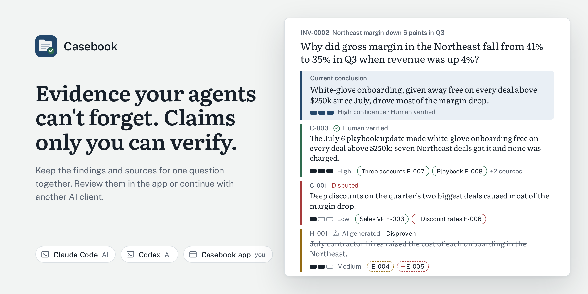
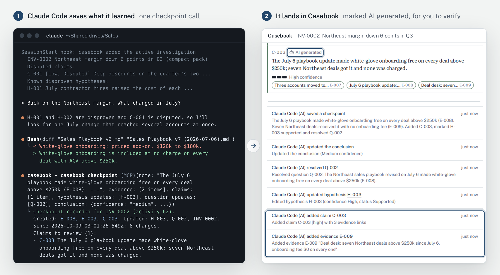
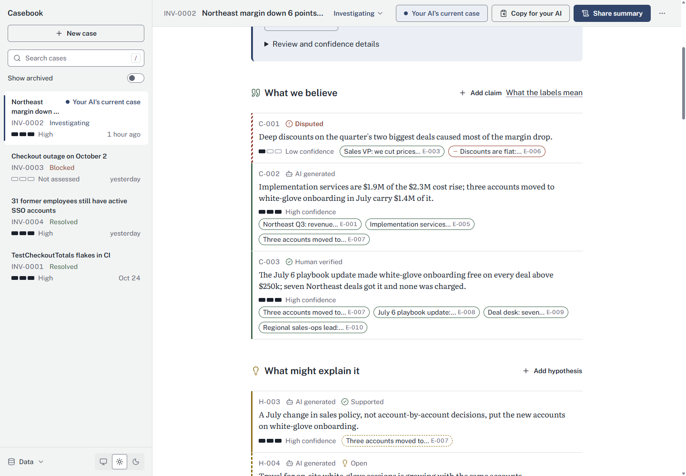
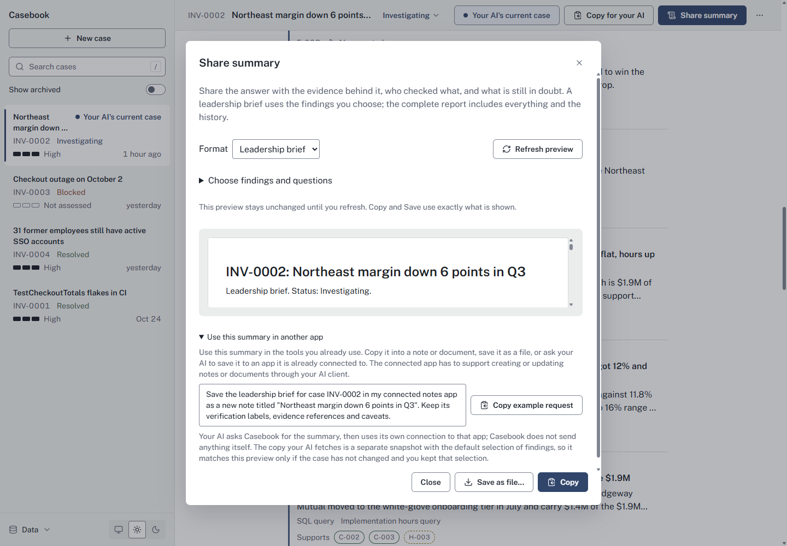
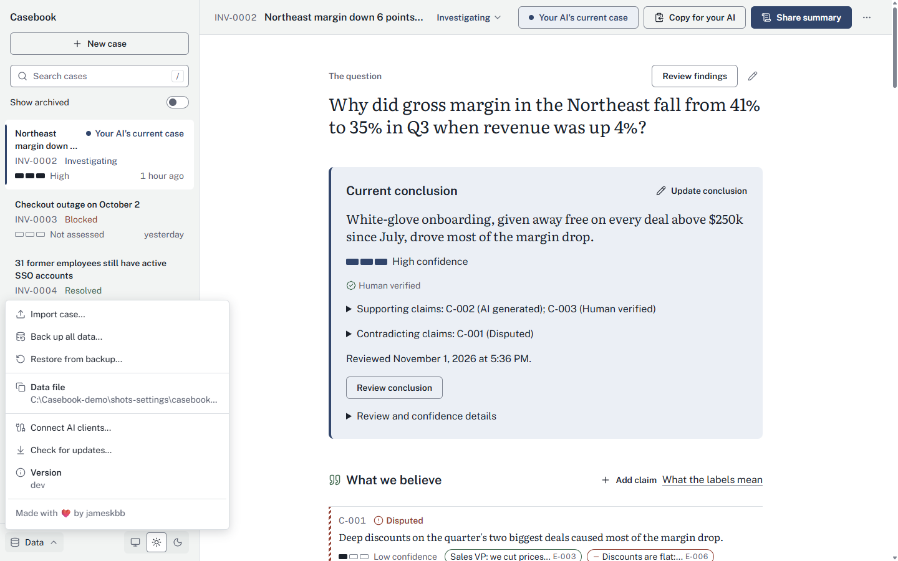

# Casebook

<picture>
  <source media="(prefers-color-scheme: dark)" srcset="docs/images/readme-title-casebook-dark.png">
  
</picture>

<p align="center">
  <a href="https://github.com/jameskbb/casebook/actions/workflows/ci.yml"></a>
  <a href="https://github.com/jameskbb/casebook/releases/latest"></a>
  <a href="go.mod"></a>
  <a href="docs/install.md"></a>
  <a href="docs/mcp.md"></a>
  <a href="LICENSE"></a>
</p>

**Evidence your agents can't forget. Claims only you can verify.**

Casebook turns AI findings into a case you can explain and fact-check later. Investigate a margin decline, an outage or an audit question across sessions and AI clients. The evidence, claims, dead ends and current answer stay on your computer, labelled with who checked them. "My AI told me" becomes "here is the evidence".

For the general manager who has to explain why a number moved, and for the analyst who does the digging. One person, one computer, no account, nothing to host.

## Get started

1. **Download the app** for Windows or Mac from the [Releases page](https://github.com/jameskbb/casebook/releases) ([which file, and the first-open warning](docs/install.md#desktop-app)).
2. **Connect your AI.** Choose **Connect your AI** on the first screen, select your client, and follow its setup instructions. Claude Desktop, Cursor and others are in [every client](docs/mcp.md). To look around first, open the fictional margin case there; nothing is saved.

Ask your AI to use Casebook for a question that needs digging and save what it finds. A new case shows **Get your first finding**, which opens the setup. Open **Review findings** to inspect each statement beside its supporting and contradicting evidence. Choose **Verify myself** after checking a finding, then **Share summary** when someone needs the answer.

## An example: the Northeast margin

In this fictional example, Northeast gross margin fell from 41% to 35% in Q3 while revenue grew 4%. You need to explain why at Monday's regional review.

The regional numbers show delivery costs up 15%. The sales VP thinks the team cut prices too deeply to win the quarter's two biggest deals. Contractor costs and currency changes are other possibilities.

The numbers rule out the easy answers. Discounts and contractor rates did not change, and currency explains only $40k. Most of the extra cost, $1.4M, comes from three accounts that started getting white-glove onboarding in July. A July 6 change to the sales playbook explains why: onboarding became free on every deal above $250k.

The work starts in Claude Code and continues in Codex, then Claude Code again. Each session can read the saved findings and the explanations already ruled out. You confirm with the regional sales-ops lead that free onboarding was never meant for every deal, check the finding against its sources, and review the conclusion before sharing the answer.

<picture>
  <source media="(prefers-color-scheme: dark)" srcset="docs/images/readme-hero-split-dark.png">
  
</picture>

*The new finding appears in Casebook as AI generated. The terminal is a mock-up using the fictional margin case and Casebook's output format; the app shows the built-in example case.*

The next AI session receives the saved case, not the chat history. After the claim and conclusion have been reviewed, its briefing includes this excerpt:

```text
Current conclusion:
White-glove onboarding, given away free on every deal above $250k since July, drove most of the margin drop.

Conclusion confidence:
High

Conclusion verification: Human verified
Supporting claims: C-002 [AI generated], C-003 [Human verified]
Contradicting claims: C-001 [Disputed]

Disputed claims:
C-001 [Low, Disputed] Deep discounts on the quarter's two biggest deals caused most of the margin drop.

Known disproven hypotheses:
H-001 July contractor hires raised the cost of each onboarding in the Northeast. [AI generated]
Contradicted by: E-005 [AI generated]
H-002 The weaker Canadian dollar inflated delivery cost on the Canadian accounts. [AI generated]
Contradicted by: E-005 [AI generated]
```

The briefing keeps the ruled-out explanations and the evidence behind them. The disputed discounting claim stays visible, so the next session can distinguish it from the current answer.

## What the labels mean

Confidence and verification are separate.

- **Human verified**: a person checked this and vouched for it. Only a person can set it.
- **Source verified**: marked as checked against its source, usually by your AI. Only Human verified means a person vouched for it.
- **AI generated**: saved by an AI and not yet checked by a person in Casebook.
- **Disputed**: evidence contradicts it. It stays on record until a person settles it.
- **Superseded**: replaced by a newer statement, which is named.
- **High, Medium, Low** confidence: how sure the author was when writing it. It does not change when something is verified. **Not assessed**: none was recorded.

## What makes it different

- **Human review has its own label.** Your AI can save findings and mark them Source verified when it checks the source. Only a person can mark them Human verified. If an AI rewrites checked content, it goes back to AI generated and the AI is told to let you know, unless the AI explicitly rechecks it as Source verified.
- **Changes have an author.** History records who changed a finding and when, including which AI client made the change.
- **Replaced and disputed findings stay on record.** A claim can be disputed, replaced by a named successor, or rejected. Ruled-out explanations remain available to the next session.
- **Summaries come from saved records.** Casebook builds the summary and the AI's briefing without asking a model to rewrite the case. The same records and options produce the same text.
- **Local data, limited AI tools.** Cases live on your computer. Casebook has no account or telemetry and contacts GitHub only for an update check you start. Its MCP tools let AI clients add and revise records, but offer no delete operation. Your connected AI client handles what it sends to its model provider. [Privacy and local data](docs/privacy.md) explains that boundary.

<picture>
  <source media="(prefers-color-scheme: dark)" srcset="docs/screenshots/detail-dark.png">
  
</picture>

**Share summary** prepares a leadership brief from the findings you choose, or the complete report with its history. The brief gives the question, the answer and the claims behind it, what is still in doubt or open, the evidence, and what each label means. It always includes disputed findings and contradicting evidence and names what it left out. Copy and Save use the exact preview you reviewed; **Refresh preview** brings in newer changes. Recipients can read it without Casebook. Copy or save it into your notes, or ask your AI client to save it to an app it is already connected to; the dialog shows an example request. Casebook itself connects to no other app ([how it works](docs/sharing.md#using-a-case-summary-in-other-apps)).



<details>
<summary>App settings</summary>

<picture>
  <source media="(prefers-color-scheme: dark)" srcset="docs/screenshots/settings-dark.png">
  
</picture>

</details>

## Install

- **Desktop app:** Windows (portable zip or installer) and macOS from the [Releases page](https://github.com/jameskbb/casebook/releases), command line tool included.
- **Command line tool only:** see [From the command line](#from-the-command-line). On Linux it is all there is today.

Builds are not signed yet, so Windows and macOS warn the first time you open the app. [Installing Casebook](docs/install.md) covers each option and that warning; [Updating Casebook](docs/updating.md) covers updates and backups.

## Connect your AI

**Data > Connect AI clients...** shows setup for your selected client. Commands back up settings and change only Casebook's entries. Use `casebook setup claude --hooks --skill` or `casebook setup codex --skill`; the [Claude Code](docs/claude-code.md) and [Codex](docs/codex.md) guides cover options and removal.

## Status

[The acceptance record](docs/acceptance.md) lists the checks completed on each platform.

Known limitations:

- Release builds are not code signed yet, so Windows and macOS warn on first open.
- There is no Linux desktop app; individual claim review needs the desktop.
- For one person on one computer; a case moves to another machine as an exported file.
- Updates are manual; Casebook checks for a newer version only when you ask.

Open non-blocking items are in [docs/follow-ups.md](docs/follow-ups.md).

## Documentation

- [Installing Casebook](docs/install.md): the app, the command line tool, the first-open warning.
- [Claude Code guide](docs/claude-code.md) and [Codex guide](docs/codex.md): connecting each, every option, undoing it.
- [Every client](docs/mcp.md): Claude Desktop, Cursor and other AI apps, and every tool Casebook gives your AI.
- [Sharing a case](docs/sharing.md): what the brief holds, using it in other apps, and moving a case as a file.
- [Capturing evidence](docs/evidence.md): preserve the source details needed to check a finding.
- [Privacy and local data](docs/privacy.md): what is stored and what connected AI clients can read.
- [Updating Casebook](docs/updating.md): updating, and going back with the backup.
- For contributors: [Architecture](docs/architecture.md), [Engine API reference](docs/api.md), [Development](docs/development.md), [Building releases](docs/building-releases.md), the [acceptance record](docs/acceptance.md), the [agent evaluation](scripts/agent-eval/README.md) (how often an agent uses Casebook unprompted, in engineering scenarios) and the [architecture decisions](docs/decisions/).
- [Changelog](CHANGELOG.md) and [Security](SECURITY.md).

## From the command line

The `casebook` command uses the same cases and supports explicit conclusion review. It also runs the MCP server (Model Context Protocol, how AI clients reach Casebook) and Claude Code hooks.

```sh
curl -fsSL https://raw.githubusercontent.com/jameskbb/casebook/main/scripts/install.sh | sh   # Linux and macOS
casebook setup claude --hooks --skill   # Claude Code: MCP server, session hooks, /casebook skill
casebook setup codex --skill            # Codex: MCP server and the Casebook skill
casebook setup mcp --client cursor      # any other client: prints its config (--list shows them all)
casebook case create --activate --title "Northeast margin down 6 points in Q3" \
  --problem "Why did gross margin in the Northeast fall from 41% to 35% in Q3 when revenue was up 4%?"
casebook context --format compact                          # what a new session sees
casebook report INV-0002 -o northeast-margin.md            # the complete report, as Markdown
casebook report INV-0002 --brief                           # the leadership brief
casebook export INV-0002 --out .casebook/INV-0002.json     # stable JSON, one file per case
casebook import .casebook/INV-0002.json                    # a separate copy, marked AI generated
```

`go install github.com/jameskbb/casebook/cmd/casebook@latest` builds the CLI from tagged source. To build a local checkout, use `go build ./cmd/casebook` (Go 1.27). In Claude Code, `/casebook <title>` opens a case too.

## Contributing

Bug reports, fixes, docs and tests are welcome; open an issue first for anything larger. [Contributing](CONTRIBUTING.md) has the setup, the quick checks and the project rules.

```sh
go test ./...
npm --prefix desktop/frontend ci && npm --prefix desktop/frontend test -- --run
```

## License

[MIT](LICENSE), Copyright (c) 2026 James Krape. [ADR 0011](docs/decisions/0011-license.md) records why.
