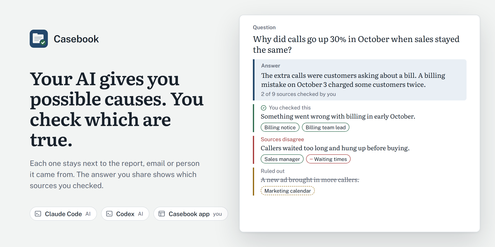
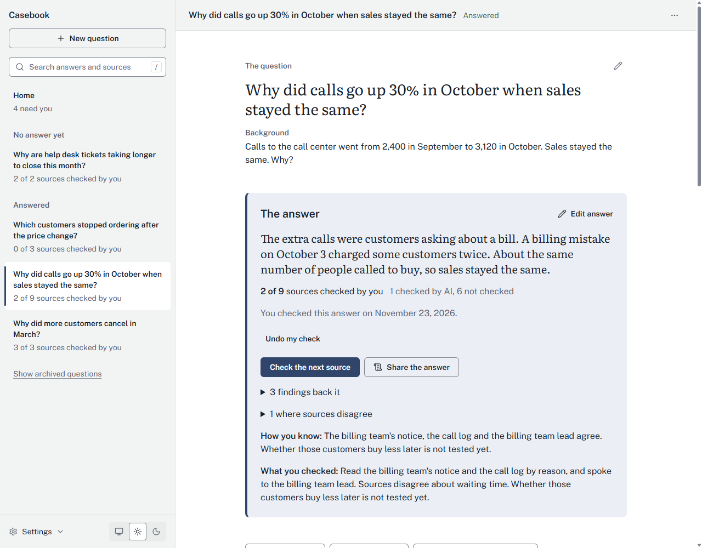
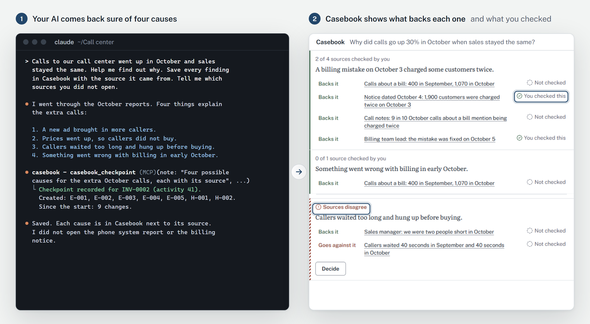

# Casebook

<picture>
  <source media="(prefers-color-scheme: dark)" srcset="docs/images/readme-title-casebook-dark.png">
  
</picture>

  
  
  
  

You ask AI why a number went up. It comes back with a long list of possible causes and some big statements, all written as if it were sure. You cannot tell which ones are true.

Casebook keeps each one next to the report, email or person it came from. You check those sources yourself, and the answer you send shows which parts you checked.

Casebook is free, for Windows and Mac, and runs on your own computer with no account. It works with AI tools that can connect to apps on your computer, such as Claude Code, Codex, the Claude desktop app, Cursor and VS Code. The ChatGPT website cannot reach apps on your computer, so it cannot use Casebook.

<picture>
  <source media="(prefers-color-scheme: dark)" srcset="docs/screenshots/detail-dark.png">
  
</picture>

## An example: calls went up, sales stayed the same

Calls to the call center went from 2,400 in September to 3,120 in October. Sales stayed the same. You ask your AI what happened. That is the **question**.

The AI comes back with four possible causes. Each one sounds sure:

1. A new ad brought in more callers.
2. Prices went up, so callers did not buy.
3. Callers waited too long and hung up before buying.
4. Something went wrong with billing in early October.

The chat does not say which of these are true.

<picture>
  <source media="(prefers-color-scheme: dark)" srcset="docs/images/readme-hero-split-dark.png">
  
</picture>

Your AI saves each cause in Casebook as a **finding**, next to its **source**: the report, the email or the person it came from. To **check** a source, you open it and see whether it says what the AI wrote. Here is what the sources say:

- **The new ad: ruled out.** The marketing calendar shows no new ads in October.
- **Higher prices: ruled out.** Prices were the same in both months.
- **Waiting too long: the sources disagree.** The sales manager says the team was two people short. The phone system shows waiting times stayed the same. Casebook shows both.
- **The billing mistake: it holds.** Calls about a bill went from 400 to 1,070. A notice from the billing team says some customers were charged twice on October 3.

You read the billing notice and choose **I checked this**. You ask the billing team lead, who confirms it, and add that as a source of your own. Then you write the **answer**:

> The extra calls were customers asking about a bill. A billing mistake on October 3 charged some customers twice. About the same number of people called to buy, so sales stayed the same.

The question now has nine sources. Under the answer, Casebook shows **2 of 9 sources checked by you**. The answer you send shows the same count.

Now your boss asks "how do you know?" You can say: I read the billing notice and spoke to the billing team lead myself. The AI ruled out ads and prices, and I have not checked those two sources yet. The sources disagree about waiting.

People ask the same kind of question about other numbers:

- Why are help desk tickets taking longer to close?
- Why did more customers cancel in March?
- Why did staff take more sick days in October?

The call center example is made up. The app's first screen has a short version of it.

## How it works

1. **Connect your AI.** This lets your AI save what it finds into Casebook. You do it once.
2. **Ask your AI a question.** Start with a message like this one, with your own question first:

   > Calls to our call center went up in October and sales stayed the same. Help me find out why. Save every finding in Casebook with the source it came from. Tell me which sources you did not open.

3. **Check the sources and share the answer.**

What your AI saves appears in the app within a few seconds.

## Install

1. Download the app for Windows or Mac from the [Releases page](https://github.com/jameskbb/casebook/releases). [Installing Casebook](docs/install.md#desktop-app) says which file to take.
2. Open it. Windows and Mac show a warning the first time you open it. The install guide shows how to get past it.
3. Choose **Connect your AI** on the first screen.

If Casebook finds Claude Code, Codex or the Claude desktop app on your computer, choose **Connect it for me**. For another AI tool, send what the app shows to whoever set it up. To look around first, choose **Open the call center example**.

## Check the sources

Open a question. The answer is at the top, with each finding and its sources under it. Every source has a label:

| Label | What it means |
|---|---|
| **Not checked** | Nobody has checked this source yet. |
| **AI checked the source** | Your AI says it went back to this source. You have not. |
| **You checked this** | You looked at this source yourself. Only you can set this, in the app. |

<picture>
  <source media="(prefers-color-scheme: dark)" srcset="docs/screenshots/investigation-dark.png">
  
</picture>

1. Choose **Check the next source**. Casebook shows one source at a time, with the finding it is about.
2. Open the report or the email it points to. Does it say what is written here?
3. Choose **I checked this** if it does, or **Skip**.
4. Where sources disagree, Casebook asks you to decide. Choose **It still holds** or **Rule this out**.
5. At the end, choose **I checked this answer**. **Undo my check** takes it back.

A finding's label comes from its sources, such as **2 of 3 sources checked by you**. A finding can also read:

- **Sources disagree**: a source goes against the finding. It stays that way until you decide.
- **You decided this holds**: you looked at both sides and chose **It still holds**.
- **Ruled out**: the finding turned out to be wrong. It is kept, so nobody looks into the same idea again.
- **Replaced**: a newer finding took its place.

Casebook cannot tell whether you really opened a source. Your AI cannot mark a source **You checked this**. Claude Code and Codex can run Casebook's own commands on your computer, though, and those can mark the answer checked in your name. If your AI rewrites a finding you decided on, or the answer you checked, your check comes off. When you add a source yourself, tick **I have looked at this source myself** if you have.

## Share the answer

The person you send the answer to does not need Casebook. They see the answer, which sources a person checked, and where sources disagree.

Choose **Share the answer** on a question. **Short version** has the answer and the findings behind it, and says what it left out. **Everything** adds the findings that were ruled out and the history. **Copy** gives you text to paste into an email. **Save as a file...** writes a web page that opens in any browser.

The shared answer is word for word what is saved in Casebook. [Share a question](docs/sharing.md) covers the rest, including [notes and document apps](docs/sharing.md#using-a-shared-answer-in-other-apps).

## Your data and known limits

- Your questions are stored on your computer. Casebook collects nothing about how you use it.
- Casebook goes online only when you choose **Look for updates...** in **Settings** and then **Look now**. It downloads nothing, so you update it yourself.
- Your AI tool can read what is saved in Casebook. Like anything else you give it, that goes to the company that makes the tool.
- Your AI can add sources, add and change findings, and write the answer. It cannot change or delete a source, and it cannot delete a finding.
- Casebook is for one person on one computer. To move a question to another computer, save a copy of it ([how](docs/sharing.md#move-a-question-or-hand-over-a-copy)). Your checks do not come with it, so you check its sources again there.

## Guides

- [Installing Casebook](docs/install.md): which file to download, and the first-open warning.
- [Share a question](docs/sharing.md): what a shared answer holds.
- [Capturing sources](docs/evidence.md): what to save about a source so someone can check it later.
- [Privacy and local data](docs/privacy.md): what is stored, and what your AI tool can read.
- [Updating Casebook](docs/updating.md): updating, and going back with a backup.
- [Changelog](CHANGELOG.md) and [Security](SECURITY.md).

## For people setting it up

Casebook is a desktop app and a command line tool named `casebook`; both open the same questions. The command line tool also runs the MCP server, the connection your AI uses to read and save questions. Linux has the command line tool only, and checking sources needs the app.

- [Claude Code guide](docs/claude-code.md) and [Codex guide](docs/codex.md): connect from a terminal, and how to undo it.
- [MCP guide](docs/mcp.md): the Claude desktop app, Cursor, VS Code and other tools, and [what a new AI session reads](docs/mcp.md#what-a-new-ai-session-reads).
- [Installing Casebook](docs/install.md#command-line-tool): the command line tool, and [the commands you use most](docs/install.md#everyday-commands).
- [Development](docs/development.md): building and testing from source.
- [Architecture](docs/architecture.md), [Engine API reference](docs/api.md), [Building releases](docs/building-releases.md) and the [agent evaluation](scripts/agent-eval/README.md).

## License

[MIT](LICENSE), Copyright (c) 2026 James Krape.
