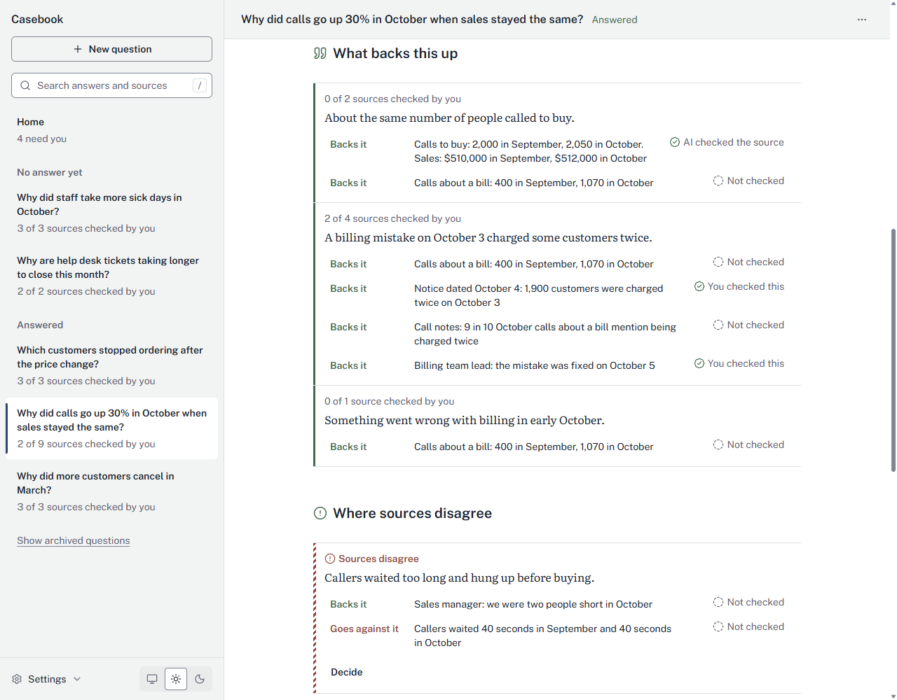

# Casebook

Casebook keeps a record of how you reached an answer with AI. You ask your AI why a number moved. It saves the question, what it found, where each finding came from, and the answer. You check the sources yourself, then share the answer.

It runs on your own computer. There is no account and nothing to host.

## How it works

1. **Connect your AI.** You do this once.
2. **Ask your AI a question.** Tell it to save what it finds in Casebook.
3. **Check the sources and share the answer.** Mark each source you have checked yourself.

<picture>
  <source media="(prefers-color-scheme: dark)" srcset="docs/screenshots/detail-dark.png">
  
</picture>

<p align="center">
  <a href="https://github.com/jameskbb/casebook/actions/workflows/ci.yml"></a>
  <a href="https://github.com/jameskbb/casebook/releases/latest"></a>
  <a href="docs/install.md"></a>
  <a href="LICENSE"></a>
</p>

## Install

1. Download the app for Windows or Mac from the [Releases page](https://github.com/jameskbb/casebook/releases). [Installing Casebook](docs/install.md#desktop-app) says which file to take.
2. Open it. Windows and macOS warn the first time, because the app is not signed yet. The install guide shows how to check your download and get past the warning.
3. Choose **Connect your AI** on the first screen and pick the AI tool you use.

For Claude Code, Codex or the Claude desktop app, choose **Connect it for me** and Casebook adds itself to the tool's settings. For another AI tool, send what the app shows to whoever set up your AI tool. To look around first, choose **Open the call center example**. The example is made up and nothing is added to your questions.

There is no Linux app yet. On Linux, Casebook is a command line tool ([For people setting it up](#for-people-setting-it-up)).

## Ask your AI a question

Start with a message like this one, and change the question to your own:

> Help me find out why calls to our call center went up when sales stayed the same. First ask me which months and which reports to use. Save one finding in Casebook with the source it came from, and note what we still need to check.

Your AI saves the question, each finding and the source each finding came from. They appear in the app within a few seconds. The work is still there tomorrow, in a new chat or in a different AI tool.

## An example: calls went up, sales stayed the same

This example is made up. It is the one built into the app.

Calls to the call center went from 2,400 in September to 3,120 in October. Sales stayed the same. Why?

The AI looked at the call log. Calls to buy barely moved: 2,000 in September, 2,050 in October. Calls about a bill went from 400 to 1,070. A notice from the billing team says 1,900 customers were charged twice on October 3.

Two other ideas were ruled out. No new ads ran in October, and prices did not change. The sales manager said the team was two people short, but the phone system's waiting times show the same 40 second wait in both months. Those two sources disagree, and Casebook says so.

You read the billing team's notice yourself and spoke to the billing team lead. You marked both as checked. The answer:

> The extra calls were customers asking about a bill. A billing mistake on October 3 charged some customers twice. About the same number of people called to buy, so sales stayed the same.

Under the answer, Casebook shows **2 of 9 sources checked by you**. It does not show a confidence score.

<picture>
  <source media="(prefers-color-scheme: dark)" srcset="docs/screenshots/investigation-dark.png">
  
</picture>

## Check the sources

Open a question. The answer is at the top. Under it is each finding, with its sources listed below the finding.

- Choose **Check the next source**. It shows one source at a time, with the finding it backs or goes against.
- Read the source. Open the report or the email it points to and compare.
- Choose **I checked this** when it holds up, or **Skip**. Casebook moves to the next source by itself.
- Then it shows each finding where sources disagree. Choose **It still holds** or **Rule this out**. When no source is left to check, the main button under the answer reads **Decide**. Each finding under Where sources disagree also has its own **Decide** button.
- Last it shows the answer. Choose **I checked this answer** when you are happy with it.

If something changes after you checked the answer, Casebook tells you to check it again. To take your check back, choose **Undo my check**.

## What the labels mean

You check sources. A finding's label comes from its sources.

- **Not checked**: nobody has checked this source yet.
- **AI checked the source**: your AI compared this with its source. You have not checked it yourself.
- **You checked this**: you checked this source. Only a person can set this label.
- **2 of 3 sources checked by you**: how many of a finding's sources you have checked.
- **Sources disagree**: a source goes against the finding. It stays until you decide the finding still holds or rule it out.

A finding can also be **Not tested yet**, **Looks right so far**, **Ruled out** or **Replaced**. Findings that were ruled out stay on record, so nobody tests the same idea twice.

If your AI rewrites something you checked, the label goes back to Not checked and your AI is told to let you know.

## Share the answer

Choose **Share the answer** on a question. Pick **Short version** for the answer and the findings behind it, or **Everything** to add the full history. **Copy** puts the text on the clipboard for an email or a document. **Save as a file** writes a web page that opens in any browser.


The reader does not need Casebook. The shared answer names each finding and source in its own words, says which ones a person checked, and always includes findings where sources disagree. The short version ends by saying what it left out. Casebook builds the text from what is saved and does not ask an AI to rewrite it.

Casebook does not connect to your notes or document app. You paste or attach the answer, or you ask your AI to save it there ([how that works](docs/sharing.md#using-a-shared-answer-in-other-apps)). [Share a question](docs/sharing.md) covers everything a shared answer holds.

## Your data

- Your questions are stored on your computer.
- Casebook has no account and collects no usage data.
- Casebook contacts the internet only when you choose **Look for updates...** in the **Settings** menu. It asks GitHub for the latest version and downloads nothing.
- Your AI tool reads what is saved in Casebook and sends it to its own provider, as it does with anything else you give it. You choose which AI tools to connect.
- Your AI can add and change findings and sources. It has no way to delete them.

[Privacy and local data](docs/privacy.md) has the details. **Settings** also has **Save a backup...** and **Bring back a backup...**.

## Known limits

- The app is not signed yet, so Windows and macOS warn the first time you open it.
- There is no Linux app. Checking individual findings and sources needs the app on Windows or Mac.
- Casebook is for one person on one computer. To move a question to another computer, or to give someone a copy, save it as a file ([Share a question](docs/sharing.md#move-a-question-or-hand-over-a-copy)).
- Updates are manual. Casebook looks for a newer version only when you ask.

## Guides

- [Installing Casebook](docs/install.md): the app, the command line tool, the first-open warning.
- [Share a question](docs/sharing.md): what a shared answer holds, using it in other apps, and moving a question as a file.
- [Capturing sources](docs/evidence.md): what to save about a source so someone can check it later.
- [Privacy and local data](docs/privacy.md): what is stored and what a connected AI tool can read.
- [Updating Casebook](docs/updating.md): updating, and going back with a backup.
- [Changelog](CHANGELOG.md) and [Security](SECURITY.md).

## For people setting it up

This part is for whoever connects the AI tool, uses a terminal or builds Casebook from source.

Casebook is a desktop app and a command line tool named `casebook`. Both open the same questions. The command line tool also runs an MCP server (Model Context Protocol, the usual way AI tools connect to other apps). That server is how your AI reads and saves questions.

Commands, tool names and file formats keep the names the engine stores. An investigation is a question, a conclusion is the answer, a claim or a hypothesis is a finding, and evidence is a source. Codes such as `INV-0002`, `C-003` and `E-007` name a question, a finding and a source. The app hides them unless you turn on **Show the codes your AI uses** under **Settings**, **Technical...**.

### Connect an AI tool

**Settings**, **Connect your AI...** in the app connects Claude Code, Codex or the Claude desktop app for you, shows whether each is connected, and keeps the line to run under **Technical details**. The same lines, from a terminal:

```sh
casebook setup claude --hooks --skill   # Claude Code: MCP server, session hooks, the /casebook command
casebook setup codex --skill            # Codex: MCP server and the Casebook skill
casebook setup mcp --client cursor      # any other tool: prints its settings (--list shows them all)
```

Setup for Claude Code and Codex backs up the settings file and changes only Casebook's entries. `--print` shows what would be written and changes nothing.

- [Claude Code guide](docs/claude-code.md) and [Codex guide](docs/codex.md): every option, and how to undo it.
- [MCP guide](docs/mcp.md): Claude Desktop, Cursor, VS Code, Windsurf, Gemini CLI and other tools, and every tool Casebook gives your AI.

### What your AI reads

A new AI session does not get your old chat. It gets a briefing built from what is saved. This is the start of the briefing for the call center example, as `casebook context --format compact` prints it:

```text
Question: INV-0002
Title: Why did calls go up 30% in October when sales stayed the same?
Status: Answered

The question:
Calls to the call center went from 2,400 in September to 3,120 in October. Sales stayed the same. Why?

Answer so far:
The extra calls were customers asking about a bill. A billing mistake on October 3 charged some customers twice. About the same number of people called to buy, so sales stayed the same.

Answer marked: Not checked
Findings behind the answer: C-002 [0 of 2 sources checked by a person], C-003 [2 of 4 sources checked by a person]
Findings against the answer: C-001 [Sources disagree]
Answer checked by a person: not yet.

Why this answer:
The billing team's notice, the call log and the billing team lead agree. Whether those customers buy less later is not tested yet.

Findings:
C-002 [0 of 2 sources checked by a person]
About the same number of people called to buy.
Why: The call log and the sales numbers agree.
Sources: E-001 [AI checked the source], E-006 [Not checked]
C-003 [2 of 4 sources checked by a person]
A billing mistake on October 3 charged some customers twice.
Why: The billing team's notice and the call notes say the same thing. The extra calls start on October 3.
Sources: E-006 [Not checked], E-007 [A person checked this], E-008 [Not checked], E-009 [A person checked this]

Findings where sources disagree:
C-001 [Sources disagree] Callers waited too long and hung up before buying.
Sources: E-002 [Not checked]
Sources against: E-003 [Not checked]
```

The briefing goes on to list the findings still being tested, what is still to find out, the findings that were ruled out, every source and the recent changes. `go run ./scripts/readme-example` prints all of it from the built-in example, and the block above is copied from that output.

### Command line

Install the command line tool on its own:

```sh
curl -fsSL https://raw.githubusercontent.com/jameskbb/casebook/main/scripts/install.sh | sh   # Linux and macOS
go install github.com/jameskbb/casebook/cmd/casebook@latest                                   # any system with Go 1.27 or later
```

On Windows it comes with the app, or as its own zip on the Releases page ([Installing Casebook](docs/install.md#command-line-tool)).

```sh
casebook inv create --activate --title "Why did calls go up 30% in October when sales stayed the same?"
casebook inv list                                        # every question, with how many sources you checked
casebook context --format compact                        # the briefing a new AI session reads
casebook report INV-0002                                 # the answer with everything, as Markdown
casebook report INV-0002 --brief -o answer.md            # the short version, saved to a file
casebook export INV-0002 --out .casebook/INV-0002.json   # the whole question as one file
casebook import .casebook/INV-0002.json                  # a separate copy, with every check cleared
```

`casebook inv conclude --review` records that you checked the answer. Checking individual findings and sources is done in the app.

### Build from source

[Development](docs/development.md) covers building and testing a checkout. It needs Go 1.27 or later and Node 24.

```sh
go build ./cmd/casebook
go test ./...
npm --prefix desktop/frontend ci && npm --prefix desktop/frontend test -- --run
```

More for developers: [Architecture](docs/architecture.md), [Engine API reference](docs/api.md), [Building releases](docs/building-releases.md) and the [agent evaluation](scripts/agent-eval/README.md), which measures how often an AI uses Casebook without being asked, in engineering tasks.

## License

[MIT](LICENSE), Copyright (c) 2026 James Krape.
