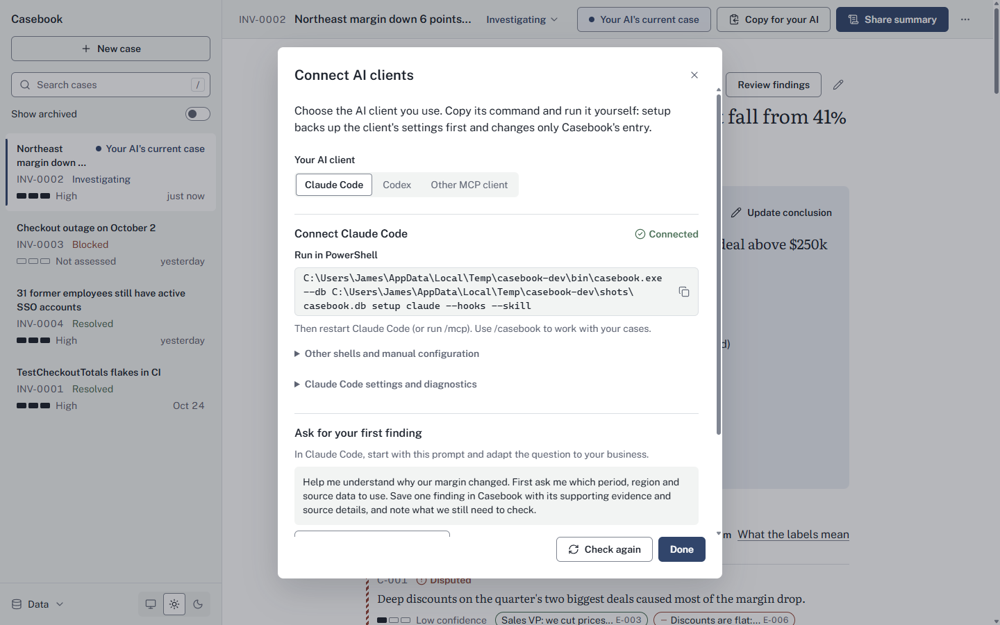

# Acceptance record

The product brief ends with a 25-step scenario that the first build must demonstrate. This page records how each step was performed on 2026-10-02 (Phase 6), what it showed, and which steps this environment cannot prove.

Environment: WSL 2 (Linux) with Go and Node, no cgo, no C compiler and no WebKit, on a Windows 11 host with the WebView2 runtime. Both Windows executables were cross-compiled from WSL with `scripts/build-windows.sh` (amd64, version stamp `7707a39`) and run on the Windows host from `%LOCALAPPDATA%\Temp\casebook-dev`: `Casebook.exe` with `bin\casebook.exe` next to it, the packaged layout of [ADR 0012](decisions/0012-cli-placement.md). The desktop app was driven through Windows UI Automation by `desktop/scripts/win-run.sh`. Every step used the throwaway data folder `casebook-dev\acc` (`--data-dir`, or `--db` for the CLI); the real per-user database and the real Claude Code and Codex configuration files were never touched.

How to read the Where column:

- **Windows host:** done for real on Windows 11 against the same database file.
- **Automated:** run in WSL by the test suites or scripts.
- **CI only:** needs GitHub runners or a Mac; this environment cannot prove it.

## Summary

| # | Step | Where | Result |
|---|------|-------|--------|
| 1 | Launch Casebook as a desktop application | Windows host | pass |
| 2 | Create a new investigation | Windows host | pass |
| 3 | Add a problem statement | Windows host | pass |
| 4 | Add evidence manually | Windows host | pass |
| 5 | Create a claim | Windows host | pass |
| 6 | Link the evidence to the claim | Windows host | pass |
| 7 | Give the claim a confidence level | Windows host | pass |
| 8 | Add a hypothesis | Windows host | pass |
| 9 | Add an open question | Windows host | pass |
| 10 | Set a current conclusion | Windows host | pass |
| 11 | Mark the investigation active | Windows host | pass |
| 12 | Close and reopen Casebook | Windows host | pass |
| 13 | Everything persists | Windows host | pass |
| 14 | Launch the Casebook MCP server | Windows host (`casebook.exe mcp`, driven from WSL) | pass |
| 15 | Retrieve the same active investigation through MCP | Windows host | pass |
| 16 | Add new evidence through MCP | Windows host | pass |
| 17 | Add or update a claim through MCP | Windows host | pass |
| 18 | Reopen or refresh the Casebook UI | Windows host | pass (live refresh and reopen) |
| 19 | The MCP-created information is visible | Windows host | pass |
| 20 | Generate a compact context pack | Windows host | pass (MCP, CLI and Copy context) |
| 21 | Configure Claude Code to access the same MCP server | Windows host, temp config | pass (real `claude mcp list`: Connected) |
| 22 | Demonstrate the expected Claude Code setup | Windows host, temp config | pass |
| 23 | Provide equivalent Codex MCP setup instructions | Windows host, temp config | pass (real `codex mcp list`) |
| 24 | Run the automated test suite successfully | Automated | pass (race detector: CI only) |
| 25 | Produce buildable Windows and macOS project configurations | Automated; macOS app CI only | Windows pass; macOS CLI and vet pass; macOS app CI only |

Steps 2 to 20 are also an automated test, `TestAcceptanceScenario` in `cmd/casebook/acceptance_test.go`: the desktop actor builds the investigation through `internal/app`, the database is closed and reopened, a real `casebook mcp` subprocess reads the active investigation and adds evidence, a linked claim and a confidence change, and a fresh engine on the same file (what the desktop shows after a refresh) sees them with the `ai claude-code` provenance, as does the compact context pack. It runs with every `go test ./...`.

## Steps 1 to 13: the desktop app

A script drove the real window through UI Automation and checked each result on screen (43 checks, all PASS). The example text below was replaced after the run with the current demo case's wording; the steps, checks and results are unchanged.

1. `Casebook.exe --data-dir ...\acc` opened on an empty folder, created `casebook.db` and showed "Start your first investigation".
2. and 3. New investigation: title "September cloud bill up 38%", primary question "Why did the cloud bill rise 38% in September when traffic was flat?", created as INV-0001 (left inactive so step 11 could set it).
4. Add evidence: E-001 "Billing export shows 214 services at debug level" with its summary.
5. to 7. Add claim: C-001 "Log ingestion drives most of the September increase.", confidence Medium, E-001 linked as Supports; the row showed "Confidence: Medium" and "E-001 supports this".
8. Add hypothesis: H-001 "The new tracing agent may also be shipping some logs twice."
9. Add question: Q-001 "Which cost center does log ingestion bill to?"
10. Conclusion "Debug logging on every service drove the increase." saved.
11. Set active: the toast said the investigation "is now the active investigation".
12. The process was stopped and `Casebook.exe` started again on the same folder.
13. The investigation, conclusion, claim, hypothesis and question were all found again, still Active.

## Steps 14 to 19: the same investigation through MCP

A small Python MCP client in WSL started the Windows CLI as the MCP server over stdio (`casebook.exe mcp --db ...\acc\casebook.db`), with the desktop app still open on the same file, and announced itself as `claude-code`:

```text
initialize: server casebook 7707a39, protocol 2025-06-18
tools/list: 20 tools
casebook_get_active_investigation -> Active investigation INV-0001 "September cloud bill up 38%" (new): 1 evidence, 1 claims, 1 hypotheses, 1 open questions.
casebook_add_evidence (sql_query, "Log ingestion by service for September") -> Added evidence E-002 to INV-0001
casebook_add_claim (high, links E-002 supports) -> Added claim C-002 to INV-0001 (high, ai_generated; supports E-002).
casebook_update_claim (C-001 confidence high, rationale) -> Updated C-001: confidence, rationale.
server exit code 0; stderr empty (stdout carried protocol messages only)
```

18. Without any action in the window, the open desktop app showed E-002 and C-002 within 6 seconds (live refresh). The app was then closed and reopened.
19. After reopening, E-002 and C-002 were on screen, C-002 marked "AI generated" and C-001 now at High confidence. The activity log names the actor `ai claude-code` for the three MCP changes and `human casebook-ui` for the earlier ones.

## Step 20: compact context pack

- MCP `casebook_get_context` with `compact: true` returned the pack: header, primary question, current conclusion, established claims C-001 [High, Human verified] and C-002 [High, AI generated] with their evidence refs, hypothesis H-001, open question Q-001, the evidence index and the recent material changes.
- `casebook.exe --db ...\acc\casebook.db context --format compact` printed the same pack, byte for byte.
- Copy context in the desktop app put the identical bytes on the real Windows clipboard, starting `Investigation: INV-0001`.

## Steps 21 to 23: Claude Code and Codex

All of these ran with the Windows CLI against throwaway homes (`USERPROFILE`, `CLAUDE_CONFIG_DIR` and `CODEX_HOME` pointed into `casebook-dev\acc-home`). The real `C:\Users\<you>\.claude.json`, `~/.claude/settings.json` and `~/.codex/config.toml` kept their modification times.

- `casebook.exe setup claude --print`, `setup claude --hooks --print` and `setup codex --print` printed the configuration shown in the [Claude Code guide](claude-code.md) and the [Codex guide](codex.md), with the Windows path JSON-escaped, hook commands double-quoted (setup has since switched Windows hook commands to single quotes, which bash reads literally), and a single-quoted TOML literal for Codex.
- `casebook.exe --db ...\acc\casebook.db setup claude --hooks` added `mcpServers.casebook` and the three hook groups; a rerun reported `unchanged` for both files.
- `casebook.exe doctor` then reported every check ok, including `claude_config ok ... casebook registered, command matches this CLI; hooks: SessionStart, Stop, PreCompact` and `mcp_startup ok initialize and tools/list completed: casebook 7707a39, 20 tools`.
- `casebook.exe hook session-start` printed the SessionStart JSON with the active investigation's pack.
- The real Claude Code CLI on Windows, with the same temporary `CLAUDE_CONFIG_DIR`, ran the health check: `claude mcp list` printed `casebook: ...\bin\casebook.exe mcp --db ...\acc\casebook.db - √ Connected`.
- The real Codex CLI on Windows, with the temporary `CODEX_HOME` that `casebook setup codex` wrote, listed `casebook` as `enabled` with the same command and args.
- The desktop app's Connect AI clients panel (Data menu), started with the temporary profile, showed the bundled `bin\casebook.exe`, Claude Code "Connected" with its session hooks, Codex "Not connected", and the one-line setup commands with `--db`, because that window used a non-default database.



A real model session was not run in this phase: Phase 4 recorded a real Claude Code session reading the investigation and adding a question through MCP (`TestRealClaudeSession`, opt-in), while the Codex model session skipped for lack of credentials in a throwaway `CODEX_HOME`.

## Step 24: automated tests

All run in WSL on the final tree:

| Check | Result |
|-------|--------|
| `CGO_ENABLED=0 go vet ./...` | pass |
| `CGO_ENABLED=0 go test -count=1 ./...` | 15 packages pass; 1148 tests pass, 6 skip (opt-in: real client sessions, client smoke tests, the stamped build check, a helper process) |
| `CASEBOOK_CLIENT_SMOKE=1 go test -run TestClientSmoke ./cmd/casebook` | 2 pass (real `claude` and `codex` CLIs read what setup wrote, in temp homes) |
| `TestStamped` with `scripts/version.sh ldflags` | pass |
| `npm --prefix desktop/frontend test -- --run` | 49 files, 411 tests pass |
| `npm --prefix desktop/frontend run build` | pass |
| `bash scripts/test-scripts.sh` | 18 cases pass |
| `shellcheck scripts/*.sh packaging/**/*.sh` | pass |
| `bash scripts/check-docs.sh` and `--release` | pass |

The race detector (`go test -race`) needs cgo, which this environment lacks; CI runs it on Linux for every push.

## Step 25: Windows and macOS builds

- `scripts/build-windows.sh --arch all` built `Casebook.exe` and `bin/casebook.exe` for windows/amd64 and windows/arm64 without cgo. All four executables carry the stamp marker `casebook-version=7707a39`, and `casebook.exe --version` printed `casebook 7707a39` on the host. The amd64 pair is what steps 1 to 23 ran.
- `GOOS=darwin go vet ./...` passes for arm64 and amd64, and `GOOS=windows go vet ./...` passes. The darwin CLI builds without cgo.
- **CI only:** the macOS app (`wails build -platform darwin/universal`, which needs cgo on a Mac), the DMG from `scripts/package-macos.sh`, the NSIS installers, signing and notarization, and the twelve release assets. They are defined in `.github/workflows/release.yml` and [Building releases](building-releases.md) and run only on GitHub's Windows and macOS runners. A WSL build of `Casebook.exe` also has no icon, version resource or manifest; the release builds add them.

## No-network audit

- Source (2026-10-02; see the [2026-10-09 rerun](#no-network-rerun-2026-10-09)): no Go file outside tests imports a network package other than `net/url` (`internal/store/store.go` builds the SQLite file URI; `internal/mcpserver/resources.go` decodes refs in resource URIs). There is no HTTP client, telemetry, analytics or update check. The desktop page has no `fetch`, XHR, WebSocket or beacon calls and a Content-Security-Policy of `default-src 'self'` with `connect-src 'self'`; fonts are bundled.
- Binaries: `net/http` is linked into both executables only through the MCP Go SDK (its optional HTTP transports and OAuth helpers). Casebook runs `mcp.StdioTransport` only and starts no listener.
- Runtime, Linux: inside `unshare -rn` (no network interfaces except a downed loopback), `casebook mcp` answered `initialize` and added evidence, and `casebook doctor` passed.
- Runtime, Windows: with the desktop app open, `Get-NetTCPConnection` showed no connections owned by `Casebook.exe`. Its WebView2 child process (`msedgewebview2.exe`, Microsoft's runtime) held two HTTPS connections to a Microsoft address; that is the shared WebView2 runtime's own traffic, which the page cannot reach or feed.
- Expected traffic outside Casebook: AI clients (Claude Code, Codex) send what they read from Casebook to their model providers, and the Windows installer may download WebView2. See [Privacy and local data](privacy.md).

## Evernote notes (2026-10-09)

> **Removed 2026-10-27.** The Evernote feature and every check in this section were retired with [ADR 0024](decisions/0024-portable-output-instead-of-evernote.md); they are no longer part of the active checklist. The section stays as the record of what 0.3.0 to 0.6.0 were checked against. See [Portable output (2026-10-27)](#portable-output-2026-10-27).

[Evernote notes](evernote.md) ([ADR 0020](decisions/0020-evernote-through-client-mcp.md), superseding the mechanism of [ADR 0019](decisions/0019-evernote-notes.md)) works through the person's AI client: the client, connected to Evernote's MCP server, fetches and writes the note; Casebook prepares the body and confirms the result. Casebook makes no network connection. The v0.2.0 build's stub server, Thrift client, OAuth and token code are gone, and so are the criteria that tested them.

**Not yet tested against Evernote's server.** No test, script, demo or screenshot contacted Evernote or used a real Evernote account. The body format of Evernote's `get_note` and `edit_note` is undocumented, so the splice is tested on Markdown, HTML and ENML fixtures only. Each criterion and the automated test that shows it, all run in WSL:

| # | Criterion | Shown by |
|---|-----------|----------|
| 1 | Outside tests, no Go file in the module imports a network package other than `net/url`; only `internal/cli` and `desktop` import `internal/evernote` (ENEX only) | `TestPackageBoundaries`, `TestBoundaryRules`; the rerun below |
| 2 | For Markdown, HTML and ENML bodies, prepare appends the block when absent and replaces it when present, keeps every byte outside the block (images, en-media, tables, code fences, checklists, Unicode), and reports `unchanged` for a body that already holds the current block | `TestSpliceGolden`, `TestHTMLInsertBeforeBody`, `TestKeepsWrapperDiv`, `TestMarkdownCRLF`, `TestEmptyBodies`, `TestPrepareAndConfirm`; fuzz tests `FuzzSpliceMarkdown`, `FuzzSpliceText`, `FuzzSpliceHTML`, `FuzzSpliceENML` |
| 3 | Broken, doubled or misplaced `BEGIN CASEBOOK` and `END CASEBOOK` lines are refused with a message naming the problem; a hand-edited block is refused, with and without a stored link, unless `overwrite` is set; an oversized body is refused | `TestSentinelProblems`, `TestMalformedENML`, `TestMarkersAccepted`, `TestOtherTextIgnored`, `TestTooLarge`, `TestPrepareRefusesHandEdits`, `TestPrepareRefusals` |
| 4 | The fingerprint ignores presentation (bullet and emphasis style, spacing, presentational attributes) and counts any change to a word, line, structure or checkbox | `TestFingerprintMarkdownVariants`, `TestFingerprintAcrossFormats`, `TestFingerprintMarkup`, `FuzzFingerprintMarkdown`, `TestNoteBlockFormatsShareAFingerprint` |
| 5 | Confirm records nothing when the block is missing, doubled or different, for a person and for an AI alike; on success it records the link and one `evernote.post` entry with the actor kind and client name | `TestVerify`, `TestConfirmRefusals`, `TestPrepareAndConfirm`; the rerun below |
| 6 | The block renders deterministically as Markdown, ENML and text, every claim and hypothesis line carrying its label; the ENML validates against the ENML DTD | `TestGoldenNoteBlockDemo`, `TestGoldenNoteBlockEmpty`, `TestGoldenNoteBlockDarkCorners`, `TestNoteBlockMarkdownEscapes`, `TestNoteBlockDeterministicUnderShuffle`, `TestNoteBlockSentinels`, `TestWrapNoteValidatesAgainstENMLDTD` |
| 7 | The three note tools are listed, documented and within the size budget; their outputs are not wrapped in the `BEGIN CASEBOOK DATA` frame; the tool descriptions, server instructions and skill carry the four-step flow; no MCP tool sets the notebook | `TestGetNoteBlock`, `TestNoMCPToolPosts`, `TestListTools`, `TestEveryToolHasATest`, `TestToolDocUpToDate`, `TestToolsListSize`, `TestInstructions`; the rerun below |
| 8 | `casebook evernote setup`, `preview` (all formats and `--enex`), `status` and `notebook` work; `connect`, `disconnect` and `post` are gone; `CASEBOOK_EVERNOTE_*` variables are ignored | `TestEvernoteSetup`, `TestEvernotePreviewFormatsAndENEX`, `TestEvernoteStatus`, `TestEvernoteNotebook`, `TestEvernoteRemovedCommands`, `TestEvernoteEnvironmentIgnored` |
| 9 | The setup guide is one text: the CLI prints it and [Evernote notes](evernote.md) carried it verbatim (that guide is now a retirement note) | `TestEvernoteSetupGuide`, `TestEvernoteSetupGuideInDocs` |
| 10 | The notebook setting is trimmed, one line, at most 256 bytes, stored per database, never logged or exported | `TestEvernoteNotebook` (app and CLI) |
| 11 | Captured `evernote_note` evidence leaves Casebook blocks out; ENEX export and capture still round-trip and cut raw detail at 64 KiB | `TestEvernoteEvidenceDropsCasebookBlocks`, `TestStripBlocks`, `TestENEXRoundTrip`, `TestCaptureENEXCutsAt64KiB`, `TestReadENEXRefusals` |
| 12 | Schema 7 widens the stored note id to 1 to 256 characters and keeps existing links; links survive backup and restore and stay out of exports | `TestMigration0007NoteIDs`, `TestNoteLinkBackupRestoreExport`, `TestNoteLinkClearAndDelete` |

Not shown: any run against Evernote's MCP server or a real Evernote account; whether Evernote's body format is Markdown, HTML or ENML; how Evernote's apps re-format a posted block; rate-limit behavior.

### No-network rerun (2026-10-09)

Run on 2026-10-09 in WSL with the 0.3.0 working tree (`go build ./cmd/casebook`), inside `unshare -rn` (a network namespace whose only interface is a downed loopback) and a fresh data folder (`CASEBOOK_HOME`):

- `casebook mcp` over stdio answered `initialize` and `tools/list` (24 tools, among them `casebook_get_note_block`, `casebook_prepare_note_update` and `casebook_confirm_note_posted`), created an investigation, and returned its block from `casebook_get_note_block` (Markdown, no data frame).
- `casebook_prepare_note_update` with a Markdown body (`My own notes.` and a list item) returned status `insert`, format `markdown` and a `new_body` that starts with the original body unchanged, not wrapped in the data frame.
- `casebook_confirm_note_posted` refused the original body (no block) and accepted `new_body`, recording one `evernote.post` activity entry with actor kind `ai` and the client name the driver reported (`audit`).
- `casebook hook session-start` printed the active investigation's pack and exited 0.
- `casebook doctor` passed (warnings only for the absent desktop app and unconfigured clients in the scratch home); it has no Evernote line any more.

Nothing tried to open a connection: every command finished normally with no network available. Source: outside tests no Go file imports a network package other than `net/url`, which `TestPackageBoundaries` enforces for the whole module.

## Not covered here

- A macOS launch of the desktop app (no Mac available).
- Human judgment items from Phase 2: the feel of the unsaved-draft guard, recovery from a real failed load, a Narrator pass over drawer menus, and the overall polish sign-off.
- Installer, signing and release workflow runs (see step 25).

## Analyst and leadership review improvements (2026-10-23)

Implemented the six product-review items against the founder's notes: verification
fidelity, accountable conclusions, focused human review, selected leadership
briefs, first-use guidance and reproducible evidence capture. The work used six
implementation agents with a separate adversarial integration review.

Checks run in WSL with Go 1.27.3 and Node 24:

- `go build ./...`, `go vet ./...` and `go test ./...`: pass.
- `go test -race -count=1 -timeout 20m ./...`: pass. The host has no system C
  compiler; this run used a checksum-verified Zig 0.17.0 C compiler in a temporary
  toolchain directory with `CGO_ENABLED=1`. Focused brief/sharing race tests were
  rerun after the final paragraph-layout change and pass.
- Frontend: 68 test files, 538 tests pass; production build passes.
- Script self-tests and documentation checks: pass. The docs gate now refuses
  missing or different `CLAUDE.md` and `AGENTS.md` files.
- New application tests exercise same-clock edits through a second database
  handle, refusal of stale human reviews, explicit dispute settlement, import
  trust lowering, old export imports, schema 8 migration and backup validation.
- Sharing tests cover one-snapshot Markdown/HTML, exact copied and saved bytes
  after AI edits or a change during the native save dialog, cache eviction,
  cancellation, private file modes and refusing saves over Casebook data.
- Capture and sample tests prove illustrative content is not saved, arbitrary
  metadata stays intact and invalid metadata is not silently replaced.

The Windows desktop was rebuilt with `desktop/scripts/win-run.sh build` and run
on the Windows host against non-default databases under the existing
`casebook-dev` temporary directory. The standard screenshot workflow completed;
additional UI Automation checks covered the new reading and capture surfaces.
Light and dark title cards and the split hero were re-rendered from their sources.

- [Conclusion review](screenshots/conclusion-review.png): confidence and
  verification remain visible; selected references and longer review details
  expand independently.
- [Focused review](screenshots/review-findings.png) and its
  [dark appearance](screenshots/review-findings-dark.png): the statement,
  individual decisions, source relationships and evidence labels appear together.
- [Leadership brief](screenshots/share-summary.png): selection and refresh are
  explicit. The expanded chooser and preview were also inspected at 960 by 640;
  the dialog scrolls while its native sharing actions stay available.
- [File capture guide](screenshots/evidence-capture.png): source-specific hints
  and the illustrative excerpt remain separate from empty evidence fields.
- [Fictional sample](screenshots/sample-case.png): its source excerpt opens,
  the sidebar remains empty and Back to your cases returns to the empty state.
  This flow was also inspected at 960 by 640.

Adversarial review corrected export-version compatibility, live refresh silently
acknowledging new review material, short briefs retaining every historical dead
end, crowded conclusion metadata and review actions falling below long sources.
These checks establish implementation behavior, not a measured five-minute
usability result with managers or analysts. Real Evernote service verification
remained outside this run (no longer applicable: the feature was removed on 2026-10-27). Conclusion attention covers only the explicitly
selected claims and their directly linked evidence, as recorded in
[ADR 0023](decisions/0023-conclusion-accountability.md).

Release preparation for 0.5.0 also ran all three reviewed-summary save and copy
tests as a native Windows test executable. They passed after restricting the
Unix mode-bit assertion to Unix platforms, consistent with the existing export
tests. The stamped Linux CLI reported `v0.5.0`, created an isolated schema 8
database, saved a conclusion and wrote a format version 2 export.

## Portable output (2026-10-27)

[ADR 0024](decisions/0024-portable-output-instead-of-evernote.md) removed the Evernote integration (the desktop panel, `casebook evernote`, the three note tools, ENEX and ENML, `internal/evernote` and `internal/noteblock`) and closed the [Evernote notes](#evernote-notes-2026-10-09) checks above as no longer applicable. What replaces them for people is the existing Share summary, `casebook report` with the new `--brief`, and `casebook_get_report` with the new `mode` input.

What the active checklist covers for this change:

- The leadership brief from `casebook report --brief` and from `casebook_get_report` with `mode` `brief` is the same deterministic text as the dialog's brief with its default selection, and `mode` `report` (the default) is unchanged.
- `casebook evernote` with any subcommand prints a pointer to the replacements and exits non-zero; `tools/list` no longer offers the note tools.
- Compatibility: `evernote_note` evidence keeps its type and label, old `evernote.post` and `evernote.unlink` History rows still render, migrations 0006 and 0007 still apply, backup and restore still carry `evernote_links`, and the case export format version is unchanged.
- The Share summary dialog shows the guidance paragraph, the example request for the open case and a working **Copy example request** button.
- Documentation: no guide describes the removed feature; [Evernote notes](evernote.md) is a retirement note that links to [Using a case summary in other apps](sharing.md#using-a-case-summary-in-other-apps).

Results, run on 2026-10-27 in WSL (Go 1.27.1, Node 24) and on the Windows host:

| Check | How | Result |
|---|---|---|
| Brief and report from the CLI, the MCP tool and the dialog agree; `--brief` rejects `--timeline`; `mode` `brief` rejects `timeline_limit`; a cut brief keeps its "Scope and omissions" section | `go test ./internal/cli ./internal/mcpserver ./internal/app` (`TestCutBriefKeepsOmissionNotice` among them) | passed |
| `casebook evernote` exits non-zero with the pointer; `tools/list` has 21 tools and none named for notes; `docs/mcp-tools.md` is current | `go test ./internal/cli ./internal/mcpserver ./cmd/casebook`; a CLI smoke run on a temporary database | passed |
| Legacy data: an `evernote_links` row survives backup and restore and is absent from the export; an import with `evernote_note` evidence and an `evernote.post` row keeps the label in the report, the brief and the context pack and keeps the post out of the material timeline; migrations 0006 and 0007 still apply | `go test ./internal/app` (`TestLegacyNoteLinkSurvivesBackupRestore`, `TestLegacyEvernoteEvidenceAndActivityImport`), `go test ./internal/store` | passed |
| Package boundaries: no network import outside `internal/update`; no `internal/store` import from a surface | `TestPackageBoundaries`, `TestBoundaryRules` | passed |
| Desktop: the Evernote entries are gone from the More and Add menus; editing an existing `evernote_note` record keeps its type; the Share summary dialog shows the guidance, the example request for the open case and the Copy example request button; the API wrapper matches the generated bindings | `npm --prefix desktop/frontend test -- --run` (63 files, 513 tests) and `npm run build` | passed |
| Live desktop (Windows build, demo data): Share summary opens, the disclosure opens, the example names INV-0002 and the case title, the sheet stays readable at 1440 by 1000 and at the 960 by 640 minimum | driven through `win-run.sh`; the README screenshot is the 1440 by 1000 capture | passed; Copy example request was not clicked in the live run (its clipboard path is the existing `CopyText` binding, covered by the frontend tests) |
| Docs: links resolve, no em dash, CLAUDE.md and AGENTS.md identical, script tests | `bash scripts/check-docs.sh`, `bash scripts/test-scripts.sh` | passed |
| Race detector | `go test -race` | not run: this machine has no C compiler, and `-race` needs cgo; CI runs it |

Not shown: no Evernote account, developer approval or live write to any external app was used. Local tests and fixtures do not establish that any particular AI client or notes app saves a brief verbatim.

## Editorial review merge (2026-10-27)

The 2026-10-26 editorial and product review pass, done on its own branch with its own acceptance pass, was written against 0.6.0 in parallel with the Evernote removal and merged into `main` after 0.7.0. The merge kept every non-Evernote change: the brief's wording and sections, the fourth Share summary group, verification-reset reporting over MCP, the first-run changes, History sentences, the CLI's Not assessed, the audience-first MCP instructions and the README. Its Evernote-specific changes (the note block renderer and goldens, the Evernote screenshots, the Evernote guide) were dropped because that feature no longer exists.

Results, run on 2026-10-27 in WSL (Go 1.27.1, Node 24) and on the Windows host, on the merged tree:

| Check | How | Result |
|---|---|---|
| Engine, CLI and MCP: the brief golden (`margin_brief.md`), the verification-reset outcomes, `casebook report --brief` and `casebook_get_report` `mode` on the merged brief renderer, the trimmed server instructions and report description within their size limits, `docs/mcp-tools.md` current | `go build ./...`, `go vet ./...`, `go test ./...` | passed |
| Desktop: the four-group chooser beside **Use this summary in another app**, the first-finding guide, History sentences, Still open lists, the API wrapper against the regenerated bindings | `npm --prefix desktop/frontend test -- --run` (63 files, 535 tests), `npm run build`, `desktop/scripts/gen-bindings.sh` (no change beyond whitespace) | passed |
| Docs and scripts: links, no em dash, README under its word limit, CLAUDE.md and AGENTS.md identical | `bash scripts/check-docs.sh`, `bash scripts/test-scripts.sh` | passed |
| Screenshots, hero inputs and the split hero re-shot from the merged Windows build; `share-summary.png`, `main.png`, `empty-state.png` and the hero were read back against the README captions | `win-run.sh build` and the screenshot and image tooling | passed; `review-findings*.png` and `sample-case.png` are the branch's hand captures, not re-shot |
| Fresh review of the merged tree for lost intent, reintroduced Evernote references, wording rules and the shared contracts | a read-only reviewer over `git diff main` | twelve findings, all fixed before the commit (stale desktop-only brief sentence in the install guide, the lost "only" in the server instructions, deferred review items copied into follow-ups, the cut-brief note, comments, a duplicated sharing section, the selection hint, the changelog) |
| Race detector | `go test -race` | not run: no C compiler on this machine; CI runs it |
| Live desktop tasks from the review branch's acceptance pass | | not repeated on the merged build beyond the screenshot run; they passed on the branch before the merge |
