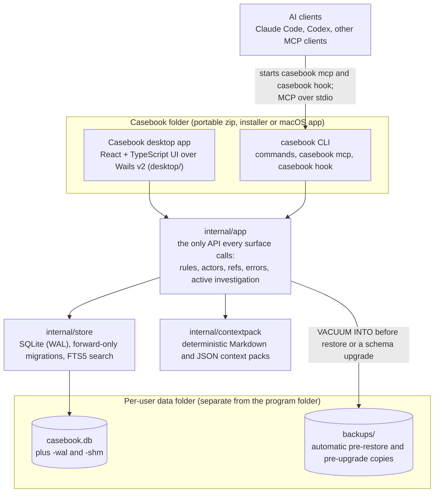

# Casebook architecture

This page is for contributors. It explains how Casebook fits together, first in plain words and then in detail. The exact engine contract is in [the engine API reference](api.md); the reasoning behind each major choice is in [the architecture decisions](decisions/).

A word on vocabulary: the unit of work, one question and everything learned about it, is an investigation in the code, the engine API, the JSON and the MCP tool names, and a case everywhere a person reads it (the desktop app, the CLI help, the guides). Its ref starts with INV either way ([ADR 0021](decisions/0021-case-is-the-word.md)).

## Overview

Casebook is one product built as one Go module:

- two executables: the `Casebook` desktop app and the `casebook` command line tool, which also runs the MCP server (`casebook mcp`) and the Claude Code hooks;
- one Go application layer, `internal/app`, that every surface calls;
- one local SQLite database file per user, shared by every process that opens it.

There is no server, no background service and no sync process. Each program opens the database file directly, does a short piece of work and keeps going. This design is a modular monolith ([ADR-0001](decisions/0001-modular-monolith.md)): the code is split into packages with strict import rules, but it is built and shipped as one thing.

## Diagram

AI clients start `casebook mcp` themselves as a child process and talk to it over its standard input and output. When hooks are installed, Claude Code also runs short `casebook hook` commands at session start, at stop and before compacting. The desktop app and every CLI, MCP or hook process open the same database file. There is no port and no account, and a change made in Claude Code shows up in the open desktop window within a few seconds (the app polls the database's change token).

A case is a small set of linked records: evidence (with where it came from), claims, hypotheses, questions and a conclusion, under a ref such as INV-0002. Evidence links to a claim or hypothesis as **supports** or **contradicts**, and each link carries its own confidence and reason.

## Packages

| Package | Role |
|---|---|
| `internal/domain` | Types, enums, refs and validation rules. Standard library only. |
| `internal/store` | SQLite access, embedded forward-only migrations, FTS5 search, transactions. |
| `internal/app` | The application service: the only API every surface calls. Re-exports every type, constant and error a surface needs. |
| `internal/app/apptest` | Test fixture shared by every phase: fresh databases, fixed clocks and the example investigation. |
| `internal/contextpack` | Builds and renders the deterministic Markdown and JSON context packs. |
| `internal/paths` | Resolves the per-user data directory and database path; creates directories owner-only. Standard library only. |
| `internal/version` | The build-stamped version and commit, shared by both executables. Imports nothing from the module. |
| `internal/deps` | Pins the third-party modules in `go.mod`; built only with the `tools` tag and imported by nothing. |
| `internal/mcpserver` | MCP tool definitions and handlers (CLI and MCP track). |
| `internal/cli` | CLI commands (CLI and MCP track). |
| `internal/integrations` | Claude Code and Codex setup and hook output (CLI and MCP track). |
| `internal/doctor` | Diagnostics behind `casebook doctor` (CLI and MCP track). |
| `internal/update` | The manual update check ([ADR 0022](decisions/0022-check-for-updates.md)): one GET to GitHub's public releases API when a person runs `casebook update` or chooses Check for updates in the desktop app, compared with the running version. Never runs on its own, downloads nothing and sends no version or identifier; only the CLI and the desktop app import it. |
| `cmd/casebook` | The CLI executable's entry point (CLI and MCP track). |
| `desktop/` | The Wails v2 desktop app: `main.go`, `wails.json` and the React frontend in `desktop/frontend` (desktop track). |

Import rules, enforced for every `.go` file in the module by `TestPackageBoundaries` in `internal/app/boundary_test.go`:

- Surfaces (desktop, CLI, MCP server, hooks, doctor) import `internal/app`, and `internal/paths` only to show or locate data files.
- Only `internal/app` (not `internal/app/apptest`) and `internal/store` may import `internal/store`.
- Only `internal/app`, `internal/store` and `internal/contextpack` may import `internal/domain`.
- Only `internal/app` may import `internal/contextpack`.
- `internal/domain` and `internal/paths` import only the standard library; `internal/contextpack` imports only the standard library and `internal/domain`.
- Nothing imports `internal/deps`.
- Only `internal/cli` and `desktop` may import `internal/update`, so the engine, the MCP server, the hooks and doctor have no network code path.
- Outside tests, no Go file in the module imports a network package (`net`, `net/http`, `crypto/tls` and the like), with one exception: the non-test files of `internal/update` may import `net/http` (and no other network package) for the update check a person asks for ([ADR 0022](decisions/0022-check-for-updates.md)). `net/url`, which only parses, is allowed everywhere. Apart from that check, Casebook makes no network connections, and it never connects to another app on the person's behalf ([ADR 0024](decisions/0024-portable-output-instead-of-evernote.md)).

A surface that reaches past `internal/app` fails `go test ./...`, so the rules hold for code added later too. `TestBoundaryRules` proves the checker catches each kind of violation.

## Two executables

A Windows program built for the graphical subsystem cannot reliably read and write standard input and output, but MCP over stdio and the CLI need exactly that. So Casebook ships two executables built from the same packages ([ADR-0002](decisions/0002-two-executables-one-product.md)): `Casebook` (the desktop app) and `casebook` (the CLI, MCP server and hooks). Only the entry points differ; no business logic is duplicated.

Windows and macOS file systems ignore letter case, so `Casebook` and `casebook` cannot share a folder. The CLI therefore lives in a `bin` folder next to the desktop executable ([ADR-0012](decisions/0012-cli-placement.md)):

- Windows: `<install folder>\Casebook.exe` and `<install folder>\bin\casebook.exe`. The installer can add only the `bin` folder to PATH.
- macOS: `Casebook.app/Contents/MacOS/Casebook` and `Casebook.app/Contents/MacOS/bin/casebook`.

Each executable finds the other with one rule. From the desktop executable, the CLI is `<its folder>/bin/casebook` (plus `.exe` on Windows); the desktop app's Connect AI clients panel uses this to show the CLI path. From the CLI, the desktop executable is `Casebook` in the folder above its own; `casebook ui` uses this to open the app.

Both executables carry the same version. The build scripts stamp `internal/version.Version`, `internal/version.Commit` and `internal/version.Marker` through `-ldflags -X` from one helper (`scripts/version.sh ldflags`), and the release workflow builds both from the same tag. See [the development guide](development.md) for how to build them.

## Data flow

A write, end to end. An AI client in Claude Code records a new piece of evidence:

1. Claude Code calls the `casebook_add_evidence` tool on its `casebook mcp` child process.
2. The MCP server built its actor once, from the client name in the MCP initialize handshake: `app.ActorMCP("claude-code")`, which is actor kind `ai` with client `claude-code`. The client name is cleaned up first because it is untrusted input.
3. The server calls `app.AddEvidence` with that actor. With no investigation ref, `internal/app` uses the active investigation.
4. `internal/app` validates and sanitizes the input, then the store writes the evidence row, allocates its ref (for example `E-005`) and writes one activity row naming the actor, all in one short `BEGIN IMMEDIATE` transaction. The change and its activity row land together or not at all.
5. The tool returns a compact result with the new ref.
6. The open desktop app calls `ChangeToken` about every 2 seconds. The token moves because another process committed, so the app reloads the visible data and the new evidence appears within a few seconds, without a restart.

A read. When a Claude Code session starts with hooks installed, Claude Code runs `casebook hook session-start`. The CLI opens the database, asks `internal/app` for the compact context pack of the active investigation (`ContextPack` with `Compact`, budget `app.DefaultCompactMaxBytes`, 6000 bytes) and prints it in the hook format Claude Code expects. With no active investigation it prints a one-line hint instead (offer a case if the session turns into an investigation; `--quiet-when-inactive` turns it off), and on any error it prints nothing and exits successfully, so the session is never blocked. At Stop, `casebook hook checkpoint` reminds Claude once per session to call `casebook_checkpoint` when the session did material work without checkpointing; before compaction the same hook can only warn the user, because Claude Code does not pass PreCompact output to the model, and the session start hook reloads the pack after compaction.

## Concurrency

Any number of processes can use the same database file at once: the desktop app, several MCP servers (one per AI client session), the CLI and hooks. There is no sync service ([ADR-0004](decisions/0004-sqlite-concurrency.md), [engine API reference section 18](api.md#18-concurrency-model)).

- SQLite runs in WAL mode with foreign keys on and a busy timeout on every connection.
- Each `App` has a writer pool of one connection that starts every write with `BEGIN IMMEDIATE`, and a reader pool of several connections. Reads run in snapshot transactions and never wait for writers.
- Every write goes through one helper that retries lock contention with jittered backoff for up to 10 seconds (the retry budget), then returns `ErrBusy` ("Casebook database is busy; try again"). Nothing is written in that case, and the call can be retried.
- Write transactions are short and do no network or file work, so contention is rare. Refs are allocated inside the write transaction, so they stay unique and contiguous under contention.
- Tests prove it: two `App` values with eight writer goroutines in one process, and three child processes plus the parent writing to one investigation at once, with exact counts, contiguous refs and no raw lock errors. The active investigation, change token, backup and restore are also tested across processes. `go test -race` runs in CI.

## Context packs

A context pack is a short summary of one case for an AI to read ([engine API reference section 12](api.md#12-context-pack)). It comes in Markdown and in JSON (`"format": "casebook.context"`, version 1).

- Deterministic: the same database state always gives the same bytes. Records are sorted by ref, there is no generation timestamp, and golden files in `internal/contextpack/testdata/` pin the output.
- Included: the investigation header and primary question, the conclusion with its confidence and rationale, established claims (active and neither disputed nor superseded) with confidence, verification, the confidence rationale and evidence refs, disputed claims, open and supported hypotheses, open and deferred questions, disproven hypotheses as one line each with the evidence that contradicted them, an evidence index (which keeps that contradicting evidence), and recent changes.
- Excluded: superseded and rejected claims, superseded hypotheses, resolved questions, evidence raw detail and metadata, and bookkeeping activity such as checkpoints.
- Budget: the compact variant for session hooks is capped at 6000 bytes of Markdown by default. Trimming drops the least important sections first, shortens statements before it removes any, keeps the disproven hypotheses (what not to retry) longer than disputed claims, and never cuts the header or the conclusion.

The same pack serves every surface: the desktop app's **Copy for your AI** button (framed as data) and its **Copy case as text** menu item (unframed), `casebook context`, the `casebook_get_context` MCP tool and the session start hook.

## Reports

A report is the same case written up for people: a Markdown document for a regional review, a status note, a pull request description or a postmortem ([engine API reference section 12a](api.md#12a-report)). It holds the title and question, the conclusion with its confidence and rationale, established claims with their verification and evidence (source label and ref), what was ruled out and the evidence that contradicted it, answered and open questions, every evidence item, and a dated timeline (UTC) of material changes with who made them.

- Deterministic, like the pack: the same records give the same bytes, and a golden file (`internal/contextpack/testdata/checkout_report.md`) pins the layout.
- One renderer (`contextpack.RenderReport`) behind `app.Report` serves every surface: `casebook report [ref]` (with `-o FILE` and `--timeline N`), the `casebook_get_report` MCP tool (framed as data, shortened to fit 64 KiB) and the desktop app's **Share summary** dialog when it shows the complete report (Copy, or Save as file...).
- The leadership brief has its own renderer (`contextpack.RenderBrief`) behind `app.SharePreview` in `brief` mode: the records the person selects, the labels explained in a fixed paragraph and every omitted record named by ref. It serves the desktop **Share summary** dialog (with explicit selection), `casebook report --brief` and `casebook_get_report` with `mode` `brief` (both with Casebook's default selection). Its golden file is `internal/contextpack/testdata/margin_brief.md` ([engine API reference, reviewed sharing snapshots](api.md#reviewed-sharing-snapshots)).
- Output is portable by design ([ADR 0024](decisions/0024-portable-output-instead-of-evernote.md)). Casebook writes Markdown for the person to copy or save; to put it in a notes or document app, the person's AI client fetches it and writes it with that app's own tools. Casebook has no adapter for any app and records nothing about where the text went.

## Record state rules

A few rules hold in the engine for every surface, so the desktop app, the CLI, the MCP server and context packs always agree:

- Status and verification are one state ([ADR-0013](decisions/0013-status-verification-invariant.md), amending ADR-0006). A claim or hypothesis is verification `superseded` exactly when its status is `superseded`, and only superseding sets it. A claim is verification `disputed` exactly when its status is `disputed`: disputing it on either axis sets both, and verifying a disputed claim (`ai_generated`, `human_verified` or `source_verified`) makes it active again. A contradicting pair is refused with an error naming `verification`. Database triggers (migration 0002) refuse a disagreeing pair from any writer.
- Only a person verifies ([ADR-0014](decisions/0014-only-people-verify.md)). The engine refuses verification `human_verified` from any actor that is not `human` on every write path (add, update, set verification, checkpoint items) with an error naming `verification`; an AI client may still mark records `source_verified` or dispute a record a person verified. When such an actor changes what a check vouched for (a statement, or an evidence field), a `human_verified` or `source_verified` record drops to `ai_generated` in the same write.
- Checkpoints are atomic. `casebook_checkpoint` applies its whole batch (evidence, claims, hypotheses, questions, updates, the conclusion and the note) in one write transaction through `CheckpointBatch`, so it is all or nothing: a failing item writes nothing, and the AI client can fix the item and resend the whole batch without duplicating anything.
- Imports are marked. Every record and historical activity row an import adds carries `imported`, and a file's `human_verified` or `source_verified` is not trusted: those records start as `ai_generated` until someone verifies them in this database ([engine API reference section 15](api.md#15-export-format-v1-and-import)).
- Deleting is for mistakes; archiving is the normal way to put a case away. Only an archived case can be deleted (with everything in it). A record that something still depends on cannot be deleted: evidence while a claim or hypothesis links it, a claim or hypothesis while another one names it as its replacement. Those requests fail with a conflict and change nothing. Every delete is permanent, writes one activity row, and never frees its ref for reuse.

## Active investigation

"The case I am working on" is one row in a settings table inside the database ([ADR-0008](decisions/0008-active-investigation-setting.md)). Setting it in the desktop app is immediately visible to the CLI, every MCP server and the hooks, and the other way round. There is no separate config file to drift out of sync. Every method that takes an investigation ref treats an empty ref as the active investigation and returns a clear error when none is set.

## Errors and logs

- Every error `internal/app` returns is safe to show to a person or an AI: validation errors name the field and the limit, and sentinel errors cover not found, conflict, no active investigation, busy, a database from a newer Casebook, integrity problems and internal failures. Raw SQLite text never leaves `internal/app`; it is logged and replaced with a sentinel.
- Each surface maps these errors its own way: a message next to a field in the desktop app, a message and non-zero exit code in the CLI, a tool error in the MCP server. The mapping table is in [engine API reference section 6](api.md#6-errors-and-surface-mapping).
- Logs carry operation names and refs only, never evidence text, raw detail or metadata. Casebook never writes logs to standard output. The MCP server logs to standard error, because its standard output carries only MCP protocol messages.

## Why there is no orchestration

Casebook stores the state of a case. The AI clients do the reasoning; people decide what matters. Casebook does not plan work, run agents or decide what happens next.

So, in line with the brief's scope discipline and the project rules in [CLAUDE.md](../CLAUDE.md), Casebook has none of these: workflow engines, DAGs, schedulers, task runners, agent orchestration, event sourcing, vector databases or embedding infrastructure, cloud sync, hosted accounts, or transcript recording. Search uses SQLite's built-in full-text index (FTS5). Each of these would add moving parts, failure modes and privacy questions without helping anyone answer the four questions: what are we trying to figure out, what do we believe, what evidence supports or contradicts it, and what is still unresolved.

If a feature seems to need one of them, open an issue to discuss it before writing code.

## Where to read more

- [Engine API reference](api.md): every method, type, error, limit and format of `internal/app`.
- [Architecture decisions](decisions/): the records behind the choices on this page.
- [Development guide](development.md): set up, test and build from source.
- [Privacy and local data](privacy.md): what is stored and where.
